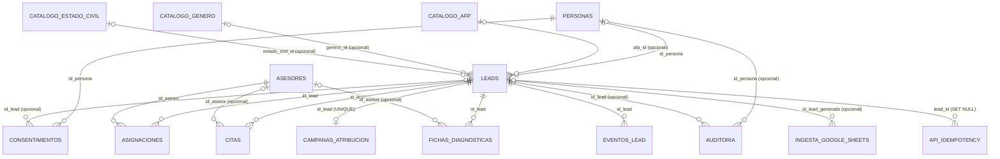

Estado: vigente
Ambiente de referencia: AWS DEV
Validacion fisica AWS DEV: completa para objetos H3.3 documentados
Ultima inspeccion: 2026-09-03
Fuentes complementarias: scripts versionados + init_test_database.py

# 02 Esquema Fisico

## Reglas de lectura

- Este documento distingue entre:
  - estado fisico actual en AWS DEV
  - contrato versionado del repositorio y testing
  - estado objetivo posterior a migraciones pendientes
- Cuando una tabla o columna no fue inspeccionada directamente en AWS DEV,
  queda marcada como `No validado todavia en AWS DEV`.
- No se muestran PII reales.

## Instantanea fisica

### `tpi.leads`

Observado en AWS DEV:

- `estado_lead` es `VARCHAR`
- `raw_payload` existe y no es operacional
- `estado_lead` tiene un indice normal
- no existe ENUM ni catalogo que gobierne los valores

Contrato fuente para el layout completo de columnas:

- `scripts/init_test_database.py`

| Columna | Tipo | Nullable | Default | PK / FK / UNIQUE / Index | Proposito |
| ------- | ---- | -------- | ------- | ------------------------ | --------- |
| `id_lead` | UUID | No | `gen_random_uuid()` | PK | Lead identifier |
| `id_persona` | UUID | No | none | FK -> `tpi.personas(id_persona)` | Link to person |
| `fecha_ingreso` | TIMESTAMPTZ | No | none | - | Ingestion timestamp |
| `afp_actual` | VARCHAR(80) | Yes | none | - | Current AFP text |
| `saldo_afp` | NUMERIC(14,2) | Yes | none | - | Balance shown as presentation later |
| `comentarios` | TEXT | Yes | none | - | Lead notes |
| `estado_lead` | VARCHAR(50) | No | `'nuevo'` | Indice observado en AWS DEV | Functional lead state |
| `prioridad` | VARCHAR(30) | Yes | none | - | Priority label |
| `origen_lead` | VARCHAR(100) | No | `'formulario_web'` | - | Source channel |
| `fuente_actual` | VARCHAR(100) | No | `'google_sheets'` | - | Current origin/source |
| `raw_payload` | JSONB | Yes | none | - | Ingestion payload only |
| `genero_id` | UUID | Yes | none | FK -> `tpi.catalogo_genero(id)` | Optional demographic reference |
| `estado_civil_id` | UUID | Yes | none | FK -> `tpi.catalogo_estado_civil(id)` | Optional civil-status reference |
| `afp_id` | UUID | Yes | none | FK -> `tpi.catalogo_afp(id)` | Optional AFP reference |
| `created_at` | TIMESTAMPTZ | No | `now()` | - | Creation timestamp |
| `updated_at` | TIMESTAMPTZ | No | `now()` | - | Update timestamp |

Notas:

- `raw_payload` is auxiliary only.
- `estado_lead` is governed primarily by application code.
- `estado_lead='asignado'` must only be produced by `assign_lead`.
- The AWS DEV inspection did not identify a state catalog or ENUM for lead
  states.

### `tpi.personas`

Contrato versionado:

- `scripts/init_test_database.py`

| Columna | Tipo | Nullable | Default | PK / FK / UNIQUE / Index | Proposito |
| ------- | ---- | -------- | ------- | ------------------------ | --------- |
| `id_persona` | UUID | No | `gen_random_uuid()` | PK | Person identifier |
| `rut` | VARCHAR(12) | No | none | UNIQUE | Identity document |
| `nombre_completo` | VARCHAR(200) | No | none | - | Display name |
| `email` | VARCHAR(150) | Yes | none | - | Contact email |
| `telefono` | VARCHAR(30) | Yes | none | - | Contact phone |
| `fecha_nacimiento` | DATE | Yes | none | - | Date of birth |
| `genero` | VARCHAR(30) | Yes | none | - | Legacy text field |
| `estado_civil` | VARCHAR(50) | Yes | none | - | Legacy text field |
| `created_at` | TIMESTAMPTZ | No | `now()` | - | Creation timestamp |
| `updated_at` | TIMESTAMPTZ | No | `now()` | - | Update timestamp |

Estado:

- `No validado todavia en AWS DEV` at column level in this document

### `tpi.asesores`

Observado en AWS DEV:

- table exists
- `id_asesor` is the PK
- `lower(nombre)` has a UNIQUE index
- advisors validated in AWS DEV were operationally active and had role
  `asesor`

Contrato versionado:

- `scripts/init_test_database.py`

| Columna | Tipo | Nullable | Default | PK / FK / UNIQUE / Index | Proposito |
| ------- | ---- | -------- | ------- | ------------------------ | --------- |
| `id_asesor` | UUID | No | `gen_random_uuid()` | PK | Advisor identifier |
| `nombre` | VARCHAR(150) | No | none | UNIQUE index on `lower(nombre)` | Advisor display/identity text |
| `email` | VARCHAR(150) | Yes | none | - | Contact or login-related value if present |
| `rol` | VARCHAR(50) | No | `'asesor'` | - | Operational role |
| `estado_disponibilidad` | VARCHAR(50) | No | `'activo'` | - | Availability flag |
| `especialidad` | VARCHAR(100) | Yes | none | - | Advisor specialty |
| `carga_activa` | INTEGER | No | `0` | - | Load counter |
| `atiende_reuniones` | BOOLEAN | No | `false` | - | Marca de quien puede ser responsable de una reunion (migracion 010) |
| `created_at` | TIMESTAMPTZ | No | `now()` | - | Creation timestamp |

Notas:

- `email` is not declared UNIQUE in the current validated contract.
- The domain term is `asesor`; the UX may display `Ejecutivo`.
- The current H3.3 assignment flow does not require mapping the authenticated
  user to `id_asesor`.
- `atiende_reuniones` (migracion 010) marca a quienes pueden ser responsables de
  una reunion de la agenda: los Socios (`rol = 'socio'`, CEO y CTO) y los
  Coordinadores (`rol = 'asesor'` con la marca en `true`). Las consultas de
  asignacion y cartera siguen filtrando por `rol = 'asesor'`, asi que los Socios
  no entran al reparto automatico.

### `tpi.asignaciones`

Observado en AWS DEV:

- table exists
- source of truth for lead-advisor relation
- no UNIQUE partial index exists yet
- multiple active rows for one lead are possible today unless prevented by the
  application

Contrato versionado:

- `scripts/sql/004_create_lead_assignments.sql`
- AWS DEV physical inspection

| Columna | Tipo | Nullable | Default | PK / FK / UNIQUE / Index | Proposito |
| ------- | ---- | -------- | ------- | ------------------------ | --------- |
| `id_asignacion` | UUID | No | `gen_random_uuid()` | PK | Assignment identifier |
| `id_lead` | UUID | No | none | FK -> `tpi.leads(id_lead)`; physical index `idx_asignaciones_lead` | Lead reference |
| `id_asesor` | UUID | No | none | FK -> `tpi.asesores(id_asesor)`; physical index `idx_asignaciones_asesor` | Advisor reference |
| `fecha_asignacion` | TIMESTAMPTZ | No | `now()` | - | Assignment timestamp |
| `asignado_por` | VARCHAR(150) | Yes | none | - | Technical actor trace |
| `regla_asignacion` | VARCHAR(100) | Yes | none | - | Assignment rule name |
| `estado_asignacion` | VARCHAR(50) | No | `'activa'` | - | Assignment lifecycle state |
| `observacion` | TEXT | Yes | none | - | Optional note |

Indices fisicos observados en AWS DEV:

- `idx_asignaciones_lead`
- `idx_asignaciones_asesor`
- `asignaciones_one_active_per_lead_uq` (UNIQUE parcial sobre `id_lead`)
- `asignaciones_pkey`

Notas:

- `estado_asignacion='activa'` is the canonical active value.
- La migracion `005_enforce_single_active_assignment.sql` creo el indice
  UNIQUE parcial `asignaciones_one_active_per_lead_uq`, condicionado por
  `estado_asignacion = 'activa'`.
- The repository bootstrap may use different index names for testing.
- Documented divergence:
  - AWS physical: `idx_asignaciones_lead`, `idx_asignaciones_asesor`,
    `asignaciones_pkey`
  - repo/versioned: `asignaciones_id_lead_idx`, `asignaciones_id_asesor_idx`

### `tpi.auditoria`

Observado en AWS DEV:

- table exists
- used for traceability events
- `detalle` is JSONB and can hold assignment metadata

Contrato versionado:

- AWS DEV physical inspection
- `scripts/init_test_database.py`
- repository write path in `app/repositories/solicitud_repository.py`

| Columna | Tipo | Nullable | Default | PK / FK / UNIQUE / Index | Proposito |
| ------- | ---- | -------- | ------- | ------------------------ | --------- |
| `id_auditoria` | UUID | No | `gen_random_uuid()` | PK | Audit event identifier |
| `id_usuario` | UUID | Yes | none | - | Optional user reference |
| `id_persona` | UUID | Yes | none | FK -> `tpi.personas(id_persona)` | Person involved in event |
| `id_lead` | UUID | Yes | none | FK -> `tpi.leads(id_lead)` | Lead involved in event |
| `accion` | VARCHAR(100) | No | none | - | Business action name |
| `tabla_afectada` | VARCHAR(100) | No | none | - | Affected table name |
| `fecha_hora` | TIMESTAMPTZ | No | `now()` | - | Event timestamp |
| `ip_origen` | VARCHAR(80) | Yes | none | - | Source IP if available |
| `detalle` | JSONB | Yes | none | - | Structured metadata |

Notas:

- `detalle` is the correct place for event metadata such as:
  - actor subject
  - assignment rule
  - previous/new state
  - advisor id
- `detalle` must not be used as an operational relationship store.

### `tpi.v_asignacion_auditoria` (vista de la migracion 007)

Read model de solo lectura sobre `tpi.auditoria` (migracion 007, change_class D).
Contrato versionado:

| Columna | Tipo | Origen | Proposito |
| ------- | ---- | ------ | --------- |
| `id_auditoria` | UUID | `tpi.auditoria.id_auditoria` | Identificador del evento |
| `id_lead` | UUID | `tpi.auditoria.id_lead` | Lead afectado |
| `fecha_hora` | TIMESTAMPTZ | `tpi.auditoria.fecha_hora` | Momento del evento |
| `actor_subject` | TEXT | `detalle->>'actor_subject'` | Identidad historica del actor |
| `id_asesor` | UUID | `detalle->>'id_asesor'` validado con CASE + regex canonica case-insensitive | Asesor; `NULL` si el valor no es UUID canonico |
| `estado_anterior` | TEXT | `detalle->>'estado_anterior'` | Estado previo a la asignacion |
| `estado_nuevo` | TEXT | `detalle->>'estado_nuevo'` | Estado posterior a la asignacion |

Notas:

- Filtro fijo: `accion = 'asignacion_lead'` AND `tabla_afectada = 'tpi.asignaciones'`.
- `security_barrier = true`.
- `REVOKE ALL ... FROM PUBLIC`; `GRANT SELECT` unicamente a `tpi_app`.
- No expone `detalle` crudo, `id_persona`, `id_usuario` ni `ip_origen`.
- **No aplicada en AWS RDS DEV al cierre de la etapa de desarrollo.**

### `tpi.v_historial_estado_lead` (vista de la migracion 008)

Read model de solo lectura sobre `tpi.auditoria` (migracion 008, change_class D).
Contrato versionado:

| Columna | Tipo | Origen | Proposito |
| ------- | ---- | ------ | --------- |
| `id_auditoria` | UUID | `tpi.auditoria.id_auditoria` | Identificador del evento |
| `id_lead` | UUID | `tpi.auditoria.id_lead` | Lead afectado |
| `fecha_hora` | TIMESTAMPTZ | `tpi.auditoria.fecha_hora` | Momento del evento |
| `actor_subject` | TEXT | `detalle->>'actor_subject'` | Identidad historica del actor |
| `estado_anterior` | TEXT | `detalle->>'estado_anterior'` | Estado previo al cambio |
| `estado_nuevo` | TEXT | `detalle->>'estado_nuevo'` | Estado posterior al cambio |

Notas:

- Filtro fijo: `accion = 'cambio_estado_lead'` AND `tabla_afectada = 'tpi.leads'`.
- `security_barrier = true`.
- `REVOKE ALL ... FROM PUBLIC`; `GRANT SELECT` unicamente a `tpi_app`.
- No expone `detalle` crudo, `id_persona`, `id_usuario` ni `ip_origen`.
- Indice de apoyo `auditoria_state_history_idx (accion, tabla_afectada, id_lead,
  fecha_hora)` justificado por EXPLAIN real.
- **No aplicada en AWS RDS DEV al cierre de la etapa de desarrollo.**

### `tpi.v_historial_simulaciones` (vista de la migracion 009)

Read model de solo lectura sobre `tpi.auditoria` (migracion 009, change_class D).
Contrato versionado:

| Columna | Tipo | Origen | Proposito |
| ------- | ---- | ------ | --------- |
| `id_auditoria` | UUID | `tpi.auditoria.id_auditoria` | Identificador del evento |
| `id_lead` | UUID | `tpi.auditoria.id_lead` | Lead afectado |
| `fecha_hora` | TIMESTAMPTZ | `tpi.auditoria.fecha_hora` | Momento del evento |
| `actor_subject` | TEXT | `detalle->>'actor_subject'` | Identidad historica del actor |
| `tipo_escenario` | TEXT | `detalle->>'tipo_escenario'` | Escenario simulado (clave maquina) |
| `version_modelo` | TEXT | `detalle->>'version_modelo'` | Version del modelo del simulador |
| `codigo_verificacion` | TEXT | `detalle->>'codigo_verificacion'` | Codigo de verificacion de la simulacion |
| `entradas` | JSONB | `detalle->'entradas'` | Entradas completas (causante y beneficiarios con todos sus campos) |
| `resultado` | JSONB | `detalle->'resultado'` | Resultado completo (pension, renta temporal y meses diferidos) |

Notas:

- Filtro fijo: `accion = 'simulacion_renta_vitalicia'` AND `tabla_afectada = 'tpi.leads'`.
- `security_barrier = true`.
- `REVOKE ALL ... FROM PUBLIC`; `GRANT SELECT` unicamente a `tpi_app`.
- No expone `detalle` crudo completo, `id_persona`, `id_usuario` ni `ip_origen`;
  expone la evidencia funcional completa (`entradas` + `resultado`) por decision del
  humano (2026-10-19): no se censura ningun dato registrado.
- Sin indice nuevo: la consulta queda servida por el indice de apoyo `auditoria_state_history_idx
  (accion, tabla_afectada, id_lead, fecha_hora)` de la migracion 008, cuyas columnas lideres
  coinciden con el filtro de la vista.
- **No aplicada en AWS RDS DEV al cierre de la etapa de desarrollo.**

### `tpi.v_historial_agenda` (vista de la migracion 011)

Read model de solo lectura sobre `tpi.auditoria` (migracion 011, change_class D).
Contrato versionado:

| Columna | Tipo | Origen | Proposito |
| ------- | ---- | ------ | --------- |
| `id_auditoria` | UUID | `tpi.auditoria.id_auditoria` | Identificador del evento |
| `id_lead` | UUID | `tpi.auditoria.id_lead` | Lead afectado |
| `fecha_hora` | TIMESTAMPTZ | `tpi.auditoria.fecha_hora` | Momento del evento |
| `accion` | TEXT | `tpi.auditoria.accion` | Accion de la agenda (`cita_agendada`, `cita_reagendada`, `cita_cancelada`, `cita_realizada`, `cita_no_asistio`) |
| `actor_subject` | TEXT | `detalle->>'actor_subject'` | Identidad historica del actor |
| `id_cita` | UUID | `detalle->>'id_cita'` validado con CASE + regex canonica case-insensitive | Reunion; `NULL` si el valor no es UUID canonico |
| `responsable_id` | UUID | `detalle->>'responsable_id'` validado con CASE + regex canonica case-insensitive | Responsable de la reunion; puede ser `NULL` |
| `estado_anterior` | TEXT | `detalle->>'estado_anterior'` | Estado previo de la reunion |
| `estado_nuevo` | TEXT | `detalle->>'estado_nuevo'` | Estado posterior de la reunion |
| `fecha_hora_anterior` | TIMESTAMPTZ | `detalle->>'fecha_hora_anterior'` convertido a timestamptz | Hora previa; puede ser `NULL` |
| `fecha_hora_nueva` | TIMESTAMPTZ | `detalle->>'fecha_hora_nueva'` convertido a timestamptz | Hora nueva; puede ser `NULL` |

Notas:

- Filtro fijo: `accion IN ('cita_agendada', 'cita_reagendada', 'cita_cancelada', 'cita_realizada',
  'cita_no_asistio')` AND `tabla_afectada = 'tpi.citas'`.
- `security_barrier = true`.
- `REVOKE ALL ... FROM PUBLIC`; `GRANT SELECT` unicamente a `tpi_app`.
- No expone `detalle` crudo, `id_persona`, `id_usuario` ni `ip_origen`; la nota y el motivo de
  cancelacion de la reunion no se registran en la auditoria de la agenda y no llegan a la vista.
- Sin indice nuevo: la consulta queda servida por el indice de apoyo `auditoria_state_history_idx
  (accion, tabla_afectada, id_lead, fecha_hora)` de la migracion 008, cuyas columnas lideres
  coinciden con el filtro de la vista.
- **No aplicada en AWS RDS DEV al cierre de la etapa de desarrollo.**

### `tpi.consentimientos`

Contrato versionado:

- `scripts/init_test_database.py`

| Columna | Tipo | Nullable | Default | PK / FK / UNIQUE / Index | Proposito |
| ------- | ---- | -------- | ------- | ------------------------ | --------- |
| `id_consentimiento` | UUID | No | `gen_random_uuid()` | PK | Consent record identifier |
| `id_persona` | UUID | No | none | FK -> `tpi.personas(id_persona)` | Person reference |
| `id_lead` | UUID | Yes | none | FK -> `tpi.leads(id_lead)` | Optional lead reference |
| `acepta_terminos` | BOOLEAN | No | `FALSE` | - | Terms acceptance |
| `acepta_politica_privacidad` | BOOLEAN | No | `FALSE` | - | Privacy acceptance |
| `fecha_aceptacion` | TIMESTAMPTZ | Yes | none | - | Acceptance timestamp |
| `version_terminos` | VARCHAR(50) | Yes | none | - | Terms version |
| `version_politica` | VARCHAR(50) | Yes | none | - | Privacy policy version |
| `ip_origen` | VARCHAR(80) | Yes | none | - | Source IP |
| `user_agent` | TEXT | Yes | none | - | Browser metadata |
| `finalidad_contacto` | BOOLEAN | No | `FALSE` | - | Contact permission |
| `created_at` | TIMESTAMPTZ | No | `now()` | - | Creation timestamp |

Estado:

- `No validado todavia en AWS DEV` at column level in this document

### Tablas operativas del pipeline de datos

Las cinco tablas siguientes las crea el proyecto hermano `tpi-data-pipeline` (`setup_db.py`; descripcion funcional en su
`docs/BASE_DE_DATOS_TPI.md`). El backoffice no las lee ni las escribe hoy. Verificado en AWS DEV el 2026-10-24 con
`scripts/dev_reset_leads.py --inspeccionar`: que existen, sus filas y que las claves foraneas apuntan como se indica (todas `NO ACTION`).
Las columnas vienen del DDL del pipeline y **no se han comparado columna a columna con DEV**. Los privilegios de `tpi_app` sobre ellas no
estan verificados. Inventario y orden de borrado: [08_DEV_DATA_INVENTORY.md](08_DEV_DATA_INVENTORY.md).

#### `tpi.campanas_atribucion`

Atribucion de campana (UTM) de un lead; una sola por lead. Filas en DEV al 2026-10-24: 69.

| Columna | Tipo | Nullable | Default | PK / FK / UNIQUE | Proposito |
| ------- | ---- | -------- | ------- | ---------------- | --------- |
| `id_atribucion` | UUID | No | `gen_random_uuid()` | PK | Identificador |
| `id_lead` | UUID | No | none | UNIQUE; FK -> `tpi.leads(id_lead)` | Lead atribuido (1:1) |
| `utm_source`, `utm_medium`, `utm_campaign`, `utm_term`, `utm_content` | VARCHAR(150) | Yes | none | - | Parametros UTM |
| `created_at` | TIMESTAMPTZ | No | `now()` | - | Creacion |

#### `tpi.eventos_lead`

Eventos relevantes de un lead (bitacora del pipeline). Filas en DEV: 69. Indice `idx_eventos_lead_id` sobre `id_lead`.

| Columna | Tipo | Nullable | Default | PK / FK / UNIQUE | Proposito |
| ------- | ---- | -------- | ------- | ---------------- | --------- |
| `id_evento` | UUID | No | `gen_random_uuid()` | PK | Identificador |
| `id_lead` | UUID | No | none | FK -> `tpi.leads(id_lead)` | Lead del evento |
| `tipo_evento` | VARCHAR(80) | No | none | - | Tipo de evento |
| `descripcion` | TEXT | Yes | none | - | Detalle |
| `fecha_evento` | TIMESTAMPTZ | No | `now()` | - | Momento |
| `usuario_responsable` | VARCHAR(150) | Yes | none | - | Quien lo origino |
| `metadata` | JSONB | Yes | none | - | Datos estructurados |

#### `tpi.citas`

Reuniones de la agenda de un lead con un asesor. Filas en DEV: 0 (sin uso todavia).

El DDL original de esta tabla es del proyecto `tpi-data-pipeline` (`setup_db.py`,
`CREATE TABLE IF NOT EXISTS`); la migracion `010` (`scripts/sql/010_extend_citas_agenda.sql`)
lo amplia sin tocar ese proyecto. La forma que se refleja aqui es la final tras `010`.

| Columna | Tipo | Nullable | Default | PK / FK / UNIQUE | Proposito |
| ------- | ---- | -------- | ------- | ---------------- | --------- |
| `id_cita` | UUID | No | `gen_random_uuid()` | PK | Identificador |
| `id_lead` | UUID | No | none | FK -> `tpi.leads(id_lead)` | Lead de la reunion |
| `id_asesor` | UUID | No | none | FK -> `tpi.asesores(id_asesor)` | Responsable de la asesoria (obligatorio desde 010) |
| `fecha_hora` | TIMESTAMPTZ | No | none | Indice `citas_fecha_hora_idx` | Fecha y hora de inicio |
| `fecha_hora_fin` | TIMESTAMPTZ | No | none | CHECK `fecha_hora_fin > fecha_hora` | Fecha y hora de fin |
| `agendada_por_subject` | TEXT | Yes | none | - | Quien agendo (subject de inicio de sesion; sin FK) |
| `agendada_por_nombre` | TEXT | Yes | none | - | Nombre visible de quien agendo |
| `canal` | VARCHAR(50) | No | `'Google Meet'` | - | Modalidad (`Google Meet`, `Llamada`, `Presencial`) |
| `estado_cita` | VARCHAR(50) | No | `'agendada'` | CHECK `agendada`/`realizada`/`no_asistio`/`cancelada` | Estado de la reunion |
| `link_reunion` | TEXT | Yes | none | - | Enlace |
| `nota` | TEXT | Yes | none | - | Nota opcional |
| `motivo_cancelacion` | TEXT | Yes | none | - | Motivo obligatorio al cancelar |
| `created_at` | TIMESTAMPTZ | No | `now()` | - | Creacion |
| `updated_at` | TIMESTAMPTZ | No | `now()` | - | Ultima actualizacion |

Integridad agregada por la migracion `010`:

- Indice unico parcial `citas_one_agendada_per_lead_uq` sobre `id_lead` cuando
  `estado_cita = 'agendada'`: un lead tiene como maximo una reunion agendada.
- Restriccion de exclusion `citas_responsable_no_superposicion_excl`
  (`EXCLUDE USING gist`, `id_asesor` con `=`, `tstzrange(fecha_hora, fecha_hora_fin)`
  con `&&`, cuando `estado_cita = 'agendada'`): un responsable no tiene dos
  reuniones que se pisen. Requiere la extension `btree_gist`.

El estado `reunion_agendada` del lead (`tpi.leads.estado_lead`) **no** esta ligado a esta tabla: hoy es solo el valor del estado.

#### `tpi.fichas_diagnosticas`

Fichas de diagnostico de un lead. Filas en DEV: 0 (sin uso todavia).

| Columna | Tipo | Nullable | Default | PK / FK / UNIQUE | Proposito |
| ------- | ---- | -------- | ------- | ---------------- | --------- |
| `id_ficha` | UUID | No | `gen_random_uuid()` | PK | Identificador |
| `id_lead` | UUID | No | none | FK -> `tpi.leads(id_lead)` | Lead de la ficha |
| `id_asesor` | UUID | Yes | none | FK -> `tpi.asesores(id_asesor)` | Asesor |
| `creada_por` | VARCHAR(150) | Yes | none | - | Autor |
| `fecha_creacion` | TIMESTAMPTZ | No | `now()` | - | Creacion |
| `version` | INTEGER | No | `1` | - | Version de la ficha |
| `formato` | VARCHAR(30) | No | `'PDF'` | - | Formato |
| `ruta_archivo` | TEXT | Yes | none | - | Ubicacion del archivo |
| `resumen_caso` | TEXT | Yes | none | - | Resumen |
| `retiro_programado`, `renta_vitalicia_simple`, `renta_vitalicia_garantizada`, `renta_vitalicia_con_aumentos` | JSONB | Yes | none | - | Alternativas evaluadas |
| `beneficios_reforma` | TEXT | Yes | none | - | Beneficios de la reforma |
| `estado_ficha` | VARCHAR(50) | No | `'borrador'` | - | Estado de la ficha |

El estado `ficha_generada` del lead tampoco esta ligado a esta tabla.

#### `tpi.ingesta_google_sheets`

Una fila por fila ingerida desde Google Sheets (control de la ingesta y sus errores). Filas en DEV: 69, todas ligadas a un lead.
Indice `idx_ingesta_estado` sobre `estado_procesamiento`.

| Columna | Tipo | Nullable | Default | PK / FK / UNIQUE | Proposito |
| ------- | ---- | -------- | ------- | ---------------- | --------- |
| `id_ingesta` | UUID | No | `gen_random_uuid()` | PK | Identificador |
| `fila_origen` | INTEGER | Yes | none | - | Numero de fila en la hoja |
| `sheet_origen` | VARCHAR(200) | No | none | - | Hoja de origen |
| `payload_original` | JSONB | No | none | - | Fila original |
| `estado_procesamiento` | VARCHAR(50) | No | `'pendiente'` | Indice | Estado del procesamiento |
| `errores_validacion` | JSONB | Yes | none | - | Errores de validacion |
| `id_lead_generado` | UUID | Yes | none | FK -> `tpi.leads(id_lead)` | Lead creado a partir de la fila (nulo si fallo) |
| `fecha_ingesta` | TIMESTAMPTZ | No | `now()` | - | Momento de la ingesta |

### Catalog tables

Contrato versionado:

- `scripts/init_test_database.py`

Shared shape:

- `id` UUID PK DEFAULT `gen_random_uuid()`
- `codigo` VARCHAR(50) NOT NULL UNIQUE
- `nombre` VARCHAR(100) NOT NULL
- `activo` BOOLEAN NOT NULL DEFAULT `TRUE`
- `orden_visual` INTEGER NOT NULL
- `created_at` TIMESTAMPTZ NOT NULL DEFAULT `now()`
- `updated_at` TIMESTAMPTZ NOT NULL DEFAULT `now()`

Tables:

- `tpi.catalogo_afp`
- `tpi.catalogo_genero`
- `tpi.catalogo_estado_civil`

Estado:

- `No validado todavia en AWS DEV` at column level in this document

### `tpi.api_idempotency`

Contrato versionado:

- `scripts/sql/003_create_api_idempotency.sql`
- `scripts/init_test_database.py`

| Columna | Tipo | Nullable | Default | PK / FK / UNIQUE / Index | Proposito |
| ------- | ---- | -------- | ------- | ------------------------ | --------- |
| `idempotency_key` | UUID | No | none | PK | Request identity |
| `payload_fingerprint` | CHAR(64) | No | none | - | Request fingerprint |
| `lead_id` | UUID | Yes | none | FK -> `tpi.leads(id_lead)` ON DELETE SET NULL | Resulting lead reference |
| `created_at` | TIMESTAMPTZ | No | `now()` | Index on `expires_at` | Creation timestamp |
| `expires_at` | TIMESTAMPTZ | No | none | CHECK `expires_at > created_at` | Expiration timestamp |

Estado:

- `No validado todavia en AWS DEV` in this release note

## Mapa de relaciones y orden de dependencias

Todas las relaciones del esquema `tpi` alrededor de `leads` y `personas`. Las claves foraneas fueron verificadas en AWS DEV el 2026-10-24
(`scripts/dev_reset_leads.py --inspeccionar`); las de los catalogos y `asesores` vienen del DDL versionado.

| Tabla hija | Columna | Padre | Obligatoria | Al borrar el padre |
| ---------- | ------- | ----- | ----------- | ------------------ |
| `leads` | `id_persona` | `personas` | Si | NO ACTION |
| `consentimientos` | `id_persona` / `id_lead` | `personas` / `leads` | Si / No | NO ACTION |
| `asignaciones` | `id_lead` / `id_asesor` | `leads` / `asesores` | Si / Si | NO ACTION |
| `auditoria` | `id_lead` / `id_persona` | `leads` / `personas` | No / No | NO ACTION |
| `campanas_atribucion` | `id_lead` (UNIQUE) | `leads` | Si | NO ACTION |
| `eventos_lead` | `id_lead` | `leads` | Si | NO ACTION |
| `citas` | `id_lead` / `id_asesor` | `leads` / `asesores` | Si / No | NO ACTION |
| `fichas_diagnosticas` | `id_lead` / `id_asesor` | `leads` / `asesores` | Si / No | NO ACTION |
| `ingesta_google_sheets` | `id_lead_generado` | `leads` | No | NO ACTION |
| `api_idempotency` | `lead_id` | `leads` | No | **SET NULL** |

Restricciones utiles al insertar o borrar:

- `personas.rut` es UNIQUE (hasta 12 caracteres; forma canonica `12345678-5`, sin puntos).
- Una sola asignacion `activa` por lead (`asignaciones_one_active_per_lead_uq`, UNIQUE parcial) y `asesores.nombre` UNIQUE en minusculas.
- Una sola atribucion por lead (`campanas_atribucion.id_lead` UNIQUE).
- Ninguna tabla depende de otra tabla dependiente: las hijas de `leads` son todas hojas. Por eso, para vaciar los leads, se borran primero
  las hijas, luego `leads` y al final `personas` (el orden completo esta en [08_DEV_DATA_INVENTORY.md](08_DEV_DATA_INVENTORY.md)).
- Los adjuntos de las notas no tienen tabla: la marca vive en `leads.comentarios` y los archivos en S3 (`leads/{id_lead}/{id_adjunto}`), de
  modo que ninguna clave foranea los protege ni los borra.

## Divergencias relevantes

- AWS DEV tiene el indice UNIQUE parcial para una sola asignacion activa por
  lead, aplicado mediante `005`.
- `tpi.asesores.email` is not UNIQUE in the current validated contract.
- `tpi.leads.estado_lead` and `tpi.asignaciones.estado_asignacion` are plain
  `VARCHAR` columns, not enums.
